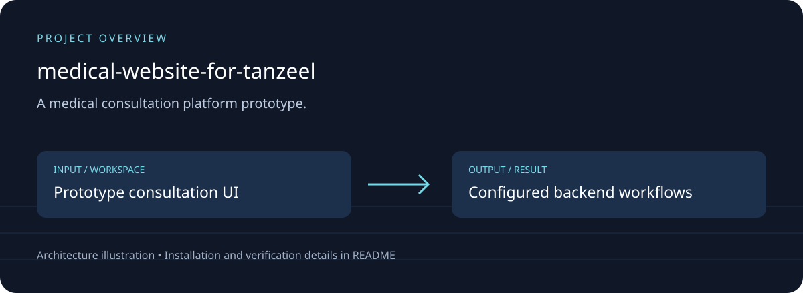

# medical-website-for-tanzeel

## Download, setup and project overview

A medical consultation platform prototype.

React frontend; consultation workflows; Supabase integration and database policies; role-oriented screens.



[Download source ZIP](https://github.com/ahpa5246-lgtm/medical-website-for-tanzeel/archive/refs/heads/main.zip) · [Changes and branches](https://github.com/ahpa5246-lgtm/medical-website-for-tanzeel/branches) · [Verification notes](docs/QUALITY_REVIEW.md)

The ZIP contains source code. Installation steps and external runtime requirements are listed below.

```bash
git clone https://github.com/ahpa5246-lgtm/medical-website-for-tanzeel.git
cd medical-website-for-tanzeel
```

From the repository directory:

```text
cd "Build Medical Consultation Platform"
# Read .mise.toml and configure the documented Supabase environment.
pnpm install
pnpm dev
```

The diagram is a project illustration. Test results and runtime limitations are recorded in [the review](docs/QUALITY_REVIEW.md); it is not a production-readiness certification.


A medical consultation platform prototype.

React frontend; consultation workflows; Supabase integration and database policies; role-oriented screens.
